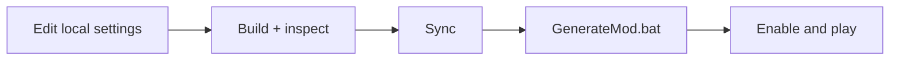

# Use and customize YSM

| Previous | You are here | Next |
| --- | --- | --- |
| [YSM overview](README.md) | Install and customize YSM | [YMB documentation](https://github.com/Yokaiste/YMB/blob/master/docs/README.md) |

For the ready-made mod, [subscribe on Steam](https://steamcommunity.com/sharedfiles/filedetails/?id=3296415395) and activate YSM in WARNO's Mod Center. The steps below are for a local version with your own settings.

## Install a local copy

1. In Steam, open WARNO's installed files, then open its `Mods` folder. Open a terminal in `Mods` and run:

   ```powershell
   .\CreateNewMod.bat MySandbox
   ```

2. Download `Deploy-YSM.exe` from the [latest release](https://github.com/Yokaiste/YSM/releases/latest). Save it in `WARNO\Mods\MySandbox`, beside `GameData` and `CommonData`, then double-click it.
3. The installer downloads the newest supported YMB and the YSM mod project, then syncs YSM's defaults. If no supported YMB exists, it offers the latest release with a compatibility warning. Cancel unless you intend to test that unsupported combination.
4. Run `GenerateMod.bat` in `MySandbox`. This compiles the files for WARNO. Open the game and activate your local mod in the Mod Center. To change settings first, follow the next sections and compile after your own sync.

You need 64-bit Windows 10 or later and an internet connection for the installer. It supplies the portable builder and precompiled YSM generator. Normal use needs no Git, compiler, or separate runtime installation. WARNO's mod scripts also need Python; follow the setup in the game's `Mods/ReadMe.txt` if those scripts fail to start.

Development archives are available from the [preview release](https://github.com/Yokaiste/YSM/releases/tag/preview). A deploy installer follows the direct archive URL embedded in its mod configuration.

```text
WARNO/Mods/MySandbox/
  Deploy-YSM.exe
  GenerateMod.bat          compile for the game
  GameData/               files YMB applies
  CommonData/
  YMB/
    YMB.exe               open the menu
    ymb.config.yaml       shared builder defaults
    .ymb/config.yaml      optional installation overrides
    mods/YSM/             the editable mod project
```

## Change a setting

Create or edit YMB/.ymb/config.yaml for this installation's settings. The commented YMB/ymb.config.yaml holds shared defaults and stays with the repository. Start the local file with version: 2, merge the example into its existing mods section, and keep unrelated settings. YAML uses spaces for indentation. Keep file-name extensions visible so the file does not end up as `config.yaml.txt`.

```yaml
version: 2
mods:
  ysm:
    variables:
      planeCap: 60
      multipliers:
        health: 1.25
    patches:
      ysm.ui.ingame.dark-theme:
        enabled: false
```

This allows 60 aircraft slots, gives YSM's tunable units 25% more health, and disables the dark HUD. The health multiplier affects the YSM features that use it; it is not a global boost to every WARNO unit.

| Setting              | Default | Effect                                                         |
| -------------------- | ------- | -------------------------------------------------------------- |
| `planeCap`           | `297`   | Available aircraft slots and their interface                   |
| `deckSlotCount`      | `80`    | Cards per category in generated divisions and the deck creator |
| `multipliers.health` | `1.0`   | Health scale for YSM features that use it                      |
| `multipliers.cost`   | `1.0`   | Cost scale for YSM features that use it                        |

`1.0` keeps a multiplier's default, `0.5` halves it, and `1.25` adds 25%. Start with one small change so you can see its effect.

For feature settings, the patch ID is the `id` at the top of its `ymb.patch.yaml`. Put overrides under that ID in `mods.ysm.patches`. Disabling a prerequisite makes builds of its dependent features fail. Keep the prerequisite enabled or disable those features too. From PowerShell inside YMB, run .\YMB.exe explain --mod ysm to inspect the selection.



## Build and play your changes

Open PowerShell inside YMB and run:

```text
.\YMB.exe build --mod ysm
```

YMB checks the project and writes a preview to `YMB/.ymb/build/output`. Read the changed files there. When they look right, run:

```text
.\YMB.exe sync --mod ysm --yes
```

Then run `GenerateMod.bat` in the WARNO mod folder and test in game. A successful YMB build produces game source files; WARNO still needs to compile them.

Use the same mod build on every player's computer for multiplayer. Double-click YMB.exe when you prefer the menu: choose the YSM project, then a command by name or number. The menu also accepts options, such as `build --mod ysm --dry-run`.

## Update your installation

Back up your settings, saved-deck `*.store.json` identities, other mod projects, and source edits outside YMB. Close running YMB commands, then run the installer again. It detects YMB and asks whether to update, warning that the entire folder and its contents will be removed.

After checking the downloads, it restores every file tracked by the installed YMB, including manual live edits and changes from other projects. It then replaces YMB and syncs a fresh YSM installation. By default, this removes local settings, identities, unselected projects, and source edits. Restoring your backed-up identities may be necessary to keep saved decks working; review compatibility before copying settings into a new version.

Use `--preserve-user-data` to keep compatible settings from both YMB config files and selected projects' `config/.ymb/` storage. Local overrides take precedence; settings for removed projects are dropped. YSM keeps its deck identities in `config/.ymb/decks/`, including compatibility profiles. The installer checks preserved data before replacement. This requires the default YMB folder layout; keep an external backup for source edits and other projects.

The installer refuses Git checkouts and builder source trees. If recovery fails, replacement stops. Keep `.ymb-install` after an interrupted update and rerun the installer to recover it. Successful deployment removes its temporary files.

Keep `modTag`, the deck identity stores, and `YMB/.ymb/state`. Changing the identities can break saved decks; deleting the state removes YMB's recovery information.

After a WARNO update, follow the [YMB update workflow](https://github.com/Yokaiste/YMB/blob/master/docs/README.md) to refresh the game files and rebuild.

## Undo or get help

To restore the game files saved by YMB, run this from PowerShell inside YMB:

```text
.\YMB.exe recover --mod ysm --yes
```

Compile again with `GenerateMod.bat` to update the playable mod. Recovery leaves your editable YSM project in place.

Recovery restores whole tracked files. If YSM shares a file with another mod, restoring it can also remove that mod's changes. Rebuild and sync the combination you want afterwards.

Sync stops if a narrower selection would erase another contributor from a shared file. Include the whole combination, or recover its shared files before switching to a different selection.

If a build stops, read the named file and suggested fix. `doctor` checks folder setup; `explain --mod ysm` explains skipped patches. Bring questions, feedback, and bug reports to the [YSM Community](https://discord.gg/33Sqn6dTjf). For build problems, use its troubleshooting forum and include the command, error, YMB version, and whether you are combining mods.

For more settings and your own patches, continue with the [YMB docs](https://github.com/Yokaiste/YMB/blob/master/docs/README.md). Before sharing a modified build, read YSM's [LICENSE](LICENSE) and the terms of any other included mod.

## Compatibility

YSM keeps its vanilla defaults. Deck generation accepts local and inline ammunition and reads damage-family defaults from the selected game data. Missing specialty entries referenced by YSM units are restored only when absent. Cloned cheat weapons retain extra magazines supplied by another mod.

For a new combination whose base already occupies YSM serializer ids, set `mods.ysm.patches.ysm.decks.generation.variables.deckGeneration.compatibility.identityProfile` to a stable name such as `my_combination`. This creates a separate pair of identity stores. Reuse the same name for later builds and updates. Existing saved decks need their original stores and profile; changing the profile is not a migration.

| Previous | You are here | Next |
| --- | --- | --- |
| [YSM overview](README.md) | Install and customize YSM | [YMB documentation](https://github.com/Yokaiste/YMB/blob/master/docs/README.md) |
