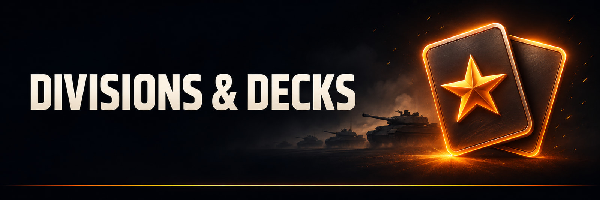
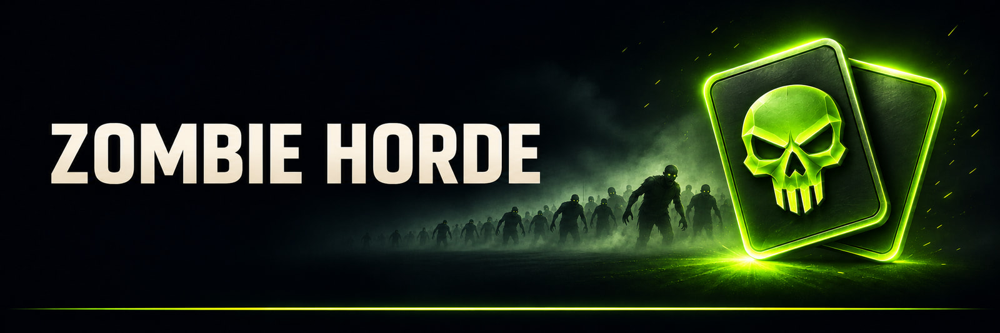
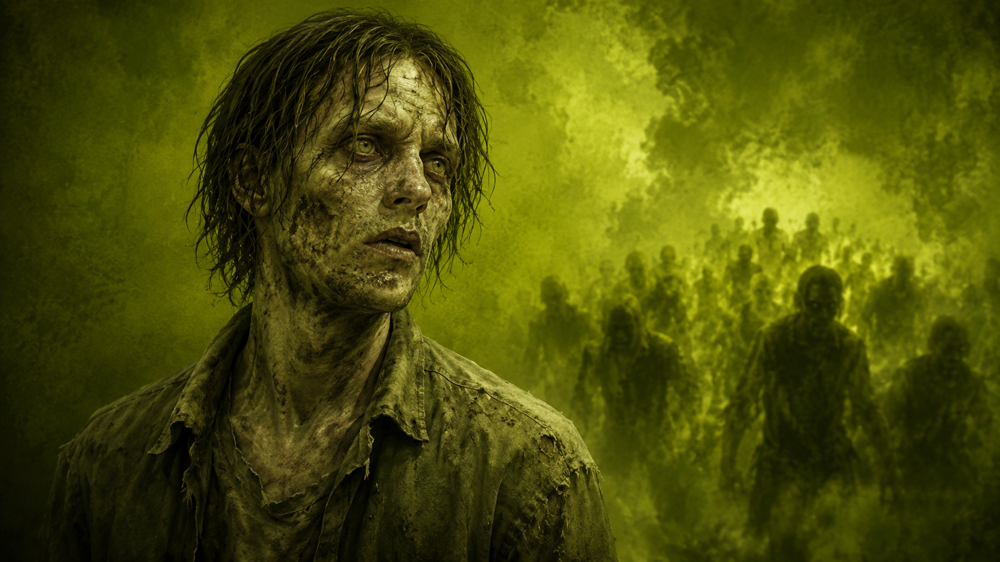
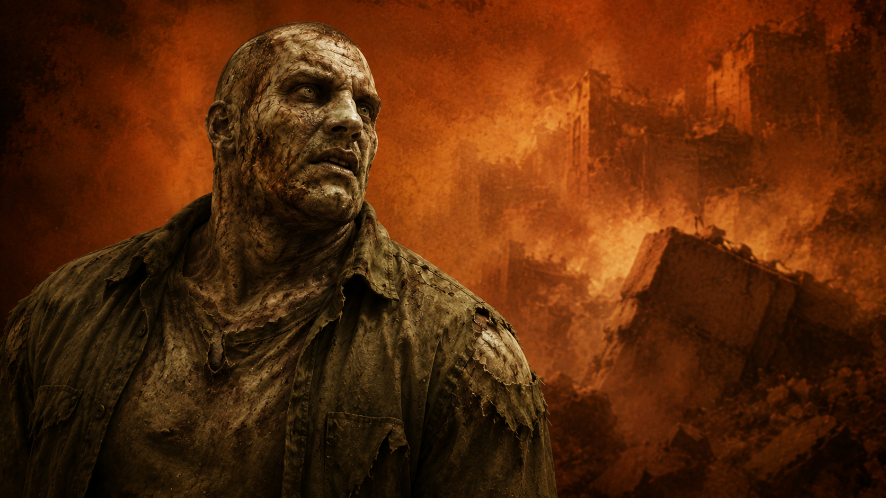
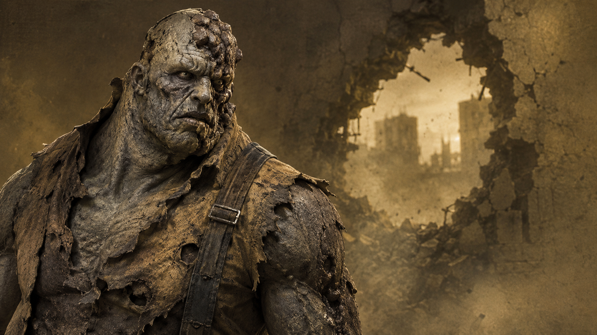
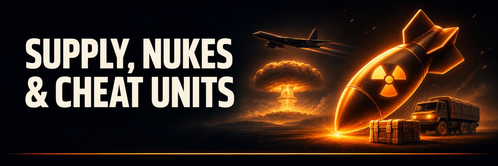
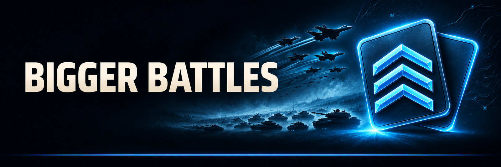
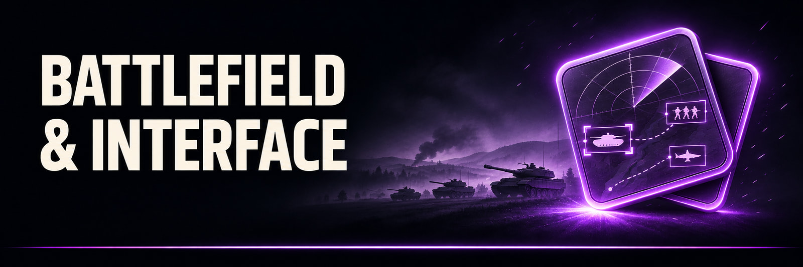
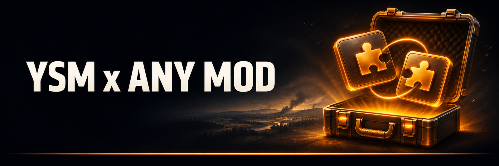
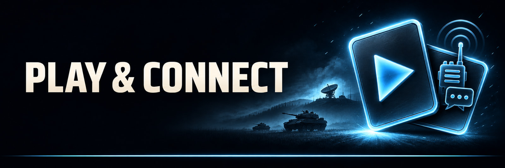

# Yokaiste's Sandbox Mod

Break the limits. Build the battle you want.

[**Play on Steam**](https://steamcommunity.com/sharedfiles/filedetails/?id=3296415395) · [Customize YSM](GUIDE.md) · [Download the installer](https://github.com/Yokaiste/YSM/releases/latest) · [YSM Community](https://discord.gg/33Sqn6dTjf)

YSM opens up country, coalition, and all-unit divisions, adds ready-made decks, and gives you room for much bigger battles. Start with a conventional army, face Zombie Horde, or send a nuclear bomber to solve a problem that probably needed infantry.

## 

Choose a country, coalition, or all-unit division. Start with a ready-made deck or build your own in the expanded armory and deck creator.

| Unlimited                                                                                             | Balanced                                                                                                                                                                               |
| ----------------------------------------------------------------------------------------------------- | -------------------------------------------------------------------------------------------------------------------------------------------------------------------------------------- |
| 999 units per card, including at higher veterancy. Plenty of room for experiments and terrible ideas. | Broad rosters with tighter reserves. Dynamic availability follows each unit. Static availability gives every unit the same count at a given veterancy, with fewer at higher veterancy. |

Balanced changes unit availability. Sandbox units remain available, so agree on house rules before somebody calls their nuclear bomber "close support."

## 

Pick the dedicated Zombie Horde division and field seven undead roles: Swarm, Breaker, Screecher, Stalker, Smoker, Pack Leader, and Demolisher. Or bring a conventional army and try to keep them out. Your front line is also their lunch.

## 

Keep an enormous army supplied, fortify a position, or reach for something wildly unfair:

- Supply helicopters, trucks, and amphibious vehicles carry **2,000,000 supply** each.
- Resupply posts, hardened bunkers, and a missile-equipped doomsday base turn a patch of ground into a stronghold.
- The **Illegal Cannon** and **Illegal Recon** give you cheat units to experiment with.
- **Two nuclear bombers** handle the problems you have stopped being reasonable about.

## 

The standard YSM setup gives you:

- **80 deck slots per category**.
- Starting resources and destruction targets up to **2,000,000**.
- Income and upkeep up to **x99**, plus more time-limit choices.
- **297 aircraft slots**, with a scrolling aircraft panel.

Your frame rate may want a word about that last one. A [custom build](GUIDE.md) can adjust these settings.

## 

Ground explosions can catch aircraft and helicopters in their blast radius.

A charcoal HUD and revised resource, selection, minimap, offmap, and chat panels help you manage the larger battles.

## 

[Yuri's WARNO Toolkit (YWT)](https://github.com/dary1337/yuri-warno-toolkit) lets you:

- Combine any mod with YSM or [WTO](https://github.com/Yokaiste/WTO); choose features and tune mod settings to your taste.
- Edit units, veterancy, and transports; create decks, recover decks from older builds or other mods, and save decks too large for in-game codes.
- Install supported mods in one click, with game-version matching, backups, and rollback.

Compatibility depends on what each mod changes. Get help in the [YSM Community](https://discord.gg/33Sqn6dTjf), and check every included mod's permissions before sharing a combined build.

## 

1. [Subscribe on Steam](https://steamcommunity.com/sharedfiles/filedetails/?id=3296415395) and let the download finish.
2. Activate YSM in WARNO's Mod Center.
3. Choose a ready-made deck or build your own, then start a Skirmish or Multiplayer match.

Players in a multiplayer match need matching mod builds. Mods that change the same gameplay or interface files can conflict when enabled separately; use a supported combined build.

Share battles, ask questions, and bring feedback or bug reports to [YSM Community Discord](https://discord.gg/33Sqn6dTjf). Use its troubleshooting forum when something breaks.

### Make it yours

To change settings or make your own version, use the [short setup and customization guide](GUIDE.md). YSM is built with [Yokaiste's Mod Builder](https://github.com/Yokaiste/YMB), which keeps the editable mod project separate from the generated game files.

## Sharing and credits

YSM is by Yokaiste. Its [license](LICENSE) allows non-commercial use and sharing with attribution, a source link, a statement of changes, and the same license. Commercial use needs written permission. See [NOTICE](NOTICE) for attribution; WARNO and third-party material keep their own terms.

---

Enjoy YSM? [Star the repository](https://github.com/Yokaiste/YSM).
