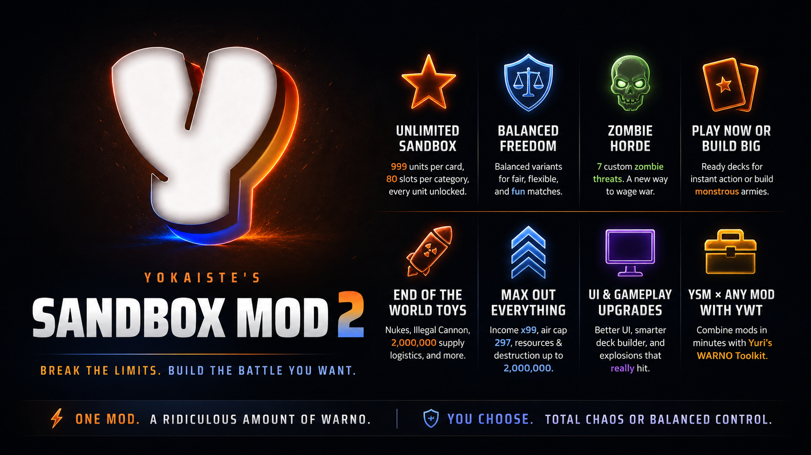

# Yokaiste’s Sandbox Mod

### Break the limits. Build the battle you want.

[**Play on Steam**](https://steamcommunity.com/sharedfiles/filedetails/?id=3296415395) · [**Source package**](https://github.com/Yokaiste/YSM/releases/latest) · [**YSM Community**](https://discord.gg/VwsfZhuWQq) · [**Yuri’s WARNO Toolkit**](https://github.com/dary1337/yuri-warno-toolkit)

YSM expands WARNO into a bigger, customizable sandbox: field vast armies, pick a ready-made deck, or face something stranger.

## Features

- **Expanded divisions and decks.** Country, coalition, and all-unit rosters, with Unlimited variants for spectacle and Balanced variants for a more restrained match.
- **Zombie Horde.** Seven custom zombie threats bring a different fight to the battlefield.
- **Extraordinary firepower and support.** Nuclear bombers, oversized supply units, fortified support, and the Illegal Cannon.
- **Bigger battles.** Expanded match lengths, income choices, resources, and aircraft limits.
- **Room to build.** Generated decks, a larger deck creator, and armory improvements make large armies practical.
- **A clearer battlefield interface.** A dark charcoal HUD with soft white text, subtle borders, and light selection accents across match controls, aircraft, and unit panels.
- **YSM × ANY MOD.** Bring the sandbox to a mod you love with **[YWT](https://github.com/dary1337/yuri-warno-toolkit)**. Compatibility varies by mod.

## Work with the source

1. Create a WARNO mod with `Mods/CreateNewMod.bat YourModName`. Put [Deploy-YSM.bat](publish/deploy/Deploy-YSM.bat) in the new folder beside `GameData` and `CommonData`, then run it to install [YMB](https://github.com/Yokaiste/YMB) and YSM. It asks before applying changes.
2. Keep local overrides in `YMB/ymb.config.yaml` under `mods.ysm.variables` or `mods.ysm.patches`. For source development, edit [mod settings](config/ymb.mod.yaml) and the owning feature in [config/patch](config/patch). Installer updates stage replacement folders and preserve local overrides and `*.store.json` identities. Other downloaded configs are replaced; keep authored changes in your own checkout.
3. From the WARNO mod folder, preview with `YMB\YMB.bat build --mod ysm`. Inspect `YMB/.ymb-build/output`, apply with `YMB\YMB.bat sync --mod ysm`, then compile using WARNO’s generation tools.

Keep `YMB/.ymb-state` for recovery, and preserve `modTag` and both `generated-decks.*.store.json` files for saved-deck identity. See YMB’s [configuration guide](../../docs/configuration.md) for overrides and feature selection, and [workflow guide](../../docs/workflow.md) for updates and recovery.

## License

Custom non-commercial attribution + source-link license — see [LICENSE](LICENSE) and [NOTICE](NOTICE).

- ✅ Play it, edit it, share it for free
- ✅ Upload it to a workshop or a code host at no charge
- 📣 Credit Yokaiste, link the source, say what you changed, pass the same license on
- ❌ No selling, paywalls, or monetized redistribution without written permission

> This list is a summary. The [LICENSE](LICENSE) is what actually applies.

YSM contains no WARNO game data — it describes changes applied to your own copy of the game, and those files stay subject to Eugen Systems' terms.
